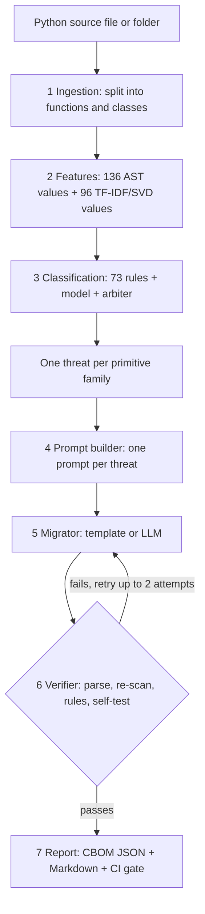

# CryptoLens / PQ-Forge

**Find quantum-vulnerable cryptography in Python code, replace it with post-quantum alternatives, and prove the replacement worked.**

CryptoLens / PQ-Forge is a course project for a Quantum Computing course. It is a Python tool that scans source code for cryptographic primitives (RSA, ECC, MD5, AES, SHA-256 and so on), labels each finding with its quantum risk, rewrites the risky code, checks the rewrite automatically, and produces a report that a build system can enforce.

The design follows the idea in the paper *Empirical Evaluation of Large Language Models for Migration of Code Fragments to Post-Quantum Cryptography* (arXiv:2606.07341). That work studies the migration step; this project builds the stages around it: detection, labelling, prompting, verification and reporting.

> **Read this first: the classifier is trained on a synthetic stand-in dataset.** The real labelled dataset described in the paper was not available to us. All accuracy numbers in this repository come from a template-generated stand-in (`data/standin_dataset.jsonl`) and say nothing about performance on real-world code. See [Limitations](#limitations).

---

## Table of contents

1. [Project overview](#project-overview)
2. [Key features](#key-features)
3. [Technology stack](#technology-stack)
4. [How it works](#how-it-works)
5. [Project structure](#project-structure)
6. [Prerequisites](#prerequisites)
7. [Installation](#installation)
8. [Running the project](#running-the-project)
9. [Web interface and HTTP endpoints](#web-interface-and-http-endpoints)
10. [Environment variables](#environment-variables)
11. [Testing](#testing)
12. [Results](#results)
13. [Limitations](#limitations)
14. [Future improvements](#future-improvements)
15. [Troubleshooting](#troubleshooting)
16. [Contributions](#contributions)
17. [License](#license)

---

## Project overview

Most public-key cryptography in use today (RSA, Diffie-Hellman, elliptic curves) can be broken by Shor's algorithm once a large quantum computer exists. Grover's algorithm also weakens symmetric keys and hashes, though only by a square-root factor. Organisations that want to move to the NIST post-quantum standards first have to answer a hard question: *where in our code are these algorithms used, and how urgent is each one?*

This project answers that question automatically for Python code and then acts on the answer:

1. It **finds** cryptographic code at function and class level.
2. It **classifies** each finding into one of four quantum-risk classes.
3. It builds **one migration prompt per threat** and produces replacement code.
4. It **verifies** every replacement (syntax, re-scan, security rules, sandboxed self-test).
5. It **reports** the result as a cryptographic bill of materials (CBOM) and a CI gate that fails the build while risky code remains.

It is meant for developers, security teams and students who want to see how an inventory-and-migrate workflow for post-quantum cryptography can be automated end to end.

## Key features

- **Hybrid detection.** 73 hand-written AST rules plus a trained model (TF-IDF/SVD text embedding fused with 136 syntax features and a logistic-regression classifier). An arbiter lets a rule win, marks a unit as contested if the model disagrees, and abstains when the model is unsure.
- **Four quantum-risk classes.** `broken_by_shor`, `already_deprecated`, `weakened_by_grover`, `quantum_safe`.
- **One threat per primitive family.** A function that uses MD5, AES-ECB and RSA produces three separate threats, three prompts and three verifications.
- **Migration targets.** ML-KEM (FIPS 203) for key exchange, ML-DSA (FIPS 204) for signatures, AES-256-GCM for symmetric encryption, SHA3-256 / HMAC-SHA3-256 for hashes and MACs.
- **Offline migrator.** A template-based rewriter that needs no network or API key. An LLM backend (Anthropic API) exists in the code but has not been tested.
- **Four-part verification.** The code must parse, a re-scan by the same classifier must find the weak primitive gone, category rules must hold, and a sandboxed self-test must run. A failed check retries once more (at most 2 attempts).
- **CBOM and CI gate.** JSON and Markdown reports. The gate fails while any Shor-class or deprecated threat is unverified; Grover-class findings are reported but never block.
- **Plain-language explanations.** Each finding says why the old primitive is a problem and why the replacement was chosen.
- **Qiskit demonstrations.** Small Shor (factoring 15) and Grover (key search) circuits on a simulator, used to explain why the risk classes differ.
- **Web interface.** A Flask app where you paste code, see the findings, prompts, final code and the quantum demo.

## Technology stack

| Area | Tool | Why it is used |
|---|---|---|
| Language | Python 3 (developed on 3.13) | The tool analyses Python code and uses Python's own parser. |
| Parsing | `ast` (standard library) | Reads code structure without executing it. |
| Machine learning | scikit-learn, NumPy, joblib | TF-IDF, SVD and logistic regression; the trained model is saved with joblib. |
| Cryptography | `cryptography` (>= 50) | Provides ML-KEM, ML-DSA, AES-GCM and SHA-3 used by the migration templates and the verifier. |
| Quantum | Qiskit | Builds and simulates the Shor and Grover circuits (statevector simulator). |
| Web | Flask, plain JavaScript | Small demo UI and JSON endpoints. |
| Tests | pytest | Unit and pipeline tests. |
| Optional | `anthropic`; `torch` + `transformers` | LLM migration backend; CodeBERT encoder. Neither is installed by default and neither has been tested. |

## How it works



| Stage | Module | What it does |
|---|---|---|
| 1 | `cryptolens/stage1_ingestion.py`, `extractor.py` | Loads code and splits it into units (functions, methods, classes); resolves import aliases. |
| 2a | `stage2a_ast_features.py` | Builds a 136-value vector from the syntax tree. |
| 2b | `stage2b_neural_encoding.py` | 96-value TF-IDF + SVD embedding (CodeBERT encoder is written but untested). |
| 3 | `stage3_classifier.py`, `rules.py`, `detector.py` | Rules, fusion classifier, arbiter; produces threats. |
| 4 | `stage4_migration.py` | Builds ChatML prompts (with a `FOCUS` line when a unit has several threats) and runs the migrator. |
| 5 | `stage5_verification.py` | Syntax check, re-scan, category rules, sandboxed run. |
| 6 | `stage6_report.py`, `ci.py` | CBOM, Markdown report, CI gate and exit code. |
| glue | `pipeline.py`, `explain.py` | Connects the stages; writes the "why replace" explanations. |
| demo | `quantum_demo.py` | Shor (N = 15) and Grover circuits in Qiskit. |

### Quantum-risk classes

| Class | Examples | Meaning | Replacement used |
|---|---|---|---|
| `broken_by_shor` | RSA, ECDSA, DH, ECDH, X25519 | A quantum computer breaks the underlying maths. | ML-DSA-87 (signatures), ML-KEM-1024 (key exchange) |
| `already_deprecated` | MD5, SHA-1, AES-ECB | Insecure even without quantum computers. | SHA3-256, AES-256-GCM |
| `weakened_by_grover` | AES-128, SHA-256, HMAC-SHA256 | Security is roughly halved in bits. | AES-256-GCM, SHA3-256, HMAC-SHA3-256 |
| `quantum_safe` | AES-256-GCM, SHA3-256 | No action needed. | none |

Replacing SHA-256 with SHA3-256 at the same output size is a policy choice, not a gain in quantum strength.

## Project structure

```text
Cryptolens/
├── cryptolens/                  # the pipeline package
│   ├── config.py                # thresholds, targets, paths, retry limit
│   ├── stage1_ingestion.py      # dataset loading and splitting code into units
│   ├── extractor.py             # import and alias resolution
│   ├── rules.py                 # the 73 detection rules and risk map
│   ├── detector.py              # rule-based scanning and threat building
│   ├── stage2a_ast_features.py  # 136-value AST feature vector
│   ├── stage2b_neural_encoding.py # TF-IDF/SVD (and CodeBERT) encoders
│   ├── stage3_classifier.py     # fusion classifier and arbiter
│   ├── stage4_migration.py      # prompts and migrators (template, Anthropic)
│   ├── stage5_verification.py   # verification checks and sandbox
│   ├── stage6_report.py         # CBOM, Markdown, CI gate logic
│   ├── explain.py               # plain-language "why replace" text
│   ├── pipeline.py              # runs all stages end to end
│   ├── ci.py                    # command-line entry point for CI
│   ├── train.py                 # trains and evaluates the classifier
│   └── quantum_demo.py          # Qiskit Shor and Grover demos
├── webapp/
│   ├── app.py                   # Flask server and JSON endpoints
│   ├── sample_app.py            # sample file shown in the UI
│   ├── templates/index.html
│   └── static/                  # app.js, style.css
├── scripts/
│   └── make_standin_dataset.py  # generates the synthetic stand-in dataset
├── data/
│   └── standin_dataset.jsonl    # synthetic, 800 entries
├── models/
│   └── classifier.joblib        # trained model (trained on the stand-in data)
├── reports/                     # metrics.json, cbom.json, report.md (generated)
├── tests/                       # test_detector.py, test_pipeline.py
├── demo.py                      # 10-function demo file with mixed crypto
├── requirements.txt
└── PROJECT_EXPLAINED.md         # long plain-language explanation of the project
```

## Prerequisites

- Python 3.10 or newer (the project was developed and tested on Python 3.13).
- `pip` and `git`.
- No accounts, API keys or database are needed for the default (offline) setup.

## Installation

```bash
git clone https://github.com/aanchal0506/cryptolens-pqforge.git
cd cryptolens-pqforge

# create and activate a virtual environment (recommended)
python -m venv .venv
# Windows PowerShell:  .venv\Scripts\Activate.ps1
# macOS / Linux:       source .venv/bin/activate

pip install -r requirements.txt
```

`requirements.txt` installs `cryptography>=50`, `scikit-learn`, `numpy`, `joblib`, `flask`, `qiskit` and `pytest`. The `anthropic`, `torch` and `transformers` packages are optional and listed as comments in that file.

## Running the project

Run all commands from the repository root.

### 1. Scan, migrate, verify and report (CI entry point)

```bash
python -m cryptolens.ci demo.py
```

Prints the CBOM as a Markdown table and writes `reports/cbom.json` and `reports/report.md`. The exit code is `0` if the gate passes and `1` if risky cryptography remains.

```bash
python -m cryptolens.ci demo.py --no-migrate    # classify only; the gate then fails (exit code 1)
python -m cryptolens.ci path/to/your/repo       # scan a whole folder of .py files
python -m cryptolens.ci demo.py --out my_reports
```

On `demo.py`, the run finds 9 threats in 7 functions (two more functions are already quantum safe), migrates and verifies all 9, and passes the gate. With `--no-migrate` the gate fails with 5 reasons.

### 2. Web interface

```bash
python webapp/app.py
```

Open <http://127.0.0.1:5000>. Paste Python code (or load the sample), run the analysis, and inspect the classification, the per-threat prompts, the explanations, the final code and the quantum demo.

### 3. Quantum demo from Python

```python
from cryptolens.quantum_demo import run_all
r = run_all()
print(r["shor"]["factors"], r["grover"]["success_probability"])   # [3, 5] 0.9613
```

### 4. Retrain the classifier (optional)

```bash
python scripts/make_standin_dataset.py        # regenerate the synthetic dataset
python -m cryptolens.train                    # retrain, overwrite models/ and reports/metrics.json
```

> Retraining **overwrites** `models/classifier.joblib` and `reports/metrics.json`. In our test, re-running it gave slightly different numbers from the metrics file shipped in this repository, so do not retrain if you want to reproduce the figures in the table below.

## Web interface and HTTP endpoints

The Flask app (`webapp/app.py`) is a demo server for local use. It has no authentication and limits input to 60,000 characters.

| Method | Path | Purpose |
|---|---|---|
| GET | `/` | The single-page interface |
| POST | `/api/analyze` | Body `{code, migrate, backend}` returns findings, stage trace, CBOM and CI gate |
| GET | `/api/metrics` | Contents of `reports/metrics.json` |
| POST | `/api/quantum` | Body `{a, secret}` returns Shor and Grover demo results |
| GET | `/api/sample` | A sample file with risky and safe cryptography |

Example:

```bash
curl -X POST http://127.0.0.1:5000/api/analyze \
  -H "Content-Type: application/json" \
  -d '{"code": "import hashlib\ndef f(d):\n    return hashlib.md5(d).hexdigest()", "migrate": true}'
```

## Testing

```bash
python -m pytest -q
```

On a clean checkout this ran **48 tests, all passing**. The tests cover the rule detector (`tests/test_detector.py`) and the full pipeline: per-threat prompts, partial failure handling, CBOM output, and CI gate behaviour (`tests/test_pipeline.py`).

## Results

Numbers in `reports/metrics.json` (held-out split of the **synthetic** stand-in dataset: 800 entries plus 133 added "no crypto" examples, 839 for training and 94 for testing):

| Configuration | Accuracy | Macro-F1 |
|---|---|---|
| Rules only | 0.904 | 0.902 |
| Model only | 1.000 | 1.000 |
| Hybrid (rules + model + arbiter) | 0.936 | 0.931 |

The 1.000 for the model alone should not be read as real accuracy: the stand-in data is generated from templates, and its algorithm labels come from the same rule layer.

End-to-end on `demo.py` (70 lines, 11 code units, 9 cryptographic functions): 9 threats found, 9 migrations verified, CI gate changes from FAIL to PASS. The CBOM has 11 components (3 Shor-class, 2 deprecated, 4 Grover-class, 2 quantum-safe).

## Limitations

- **Synthetic training data.** No result here is a benchmark against the real dataset from the paper.
- **Python only**, analysed at function and class level. Wrapper and helper functions can be missed (for example, a key passed in as a parameter with only `.exchange()` called on it is not detected). AES-GCM with an unknown key size is flagged as Grover-weakened by design.
- **Whole-function replacement.** The template migrator replaces functions; when several threats sit in one function, the fixes are produced separately and not merged into one rewritten function.
- **Verification is not a proof of equivalent behaviour.** It checks syntax, a re-scan by the same classifier, category rules and a self-test of the new code.
- **Untested components.** The CodeBERT encoder and the Anthropic (LLM) backend are written but have not been run or evaluated.
- **Quantum demos are toy-sized.** Shor's circuit works only for N = 15 on a simulator; real RSA-2048 needs thousands of logical qubits. The demos illustrate the risk classes and do not attack real keys.
- Not intended for production use.

## Future improvements

These are potential enhancements, not implemented features:

- Obtain the real labelled dataset and re-run the evaluation.
- Compare the TF-IDF encoder with CodeBERT / GraphCodeBERT.
- Test an LLM migrator inside the same verification loop.
- Support other languages and detect wrapper functions through call-graph analysis.
- Merge multi-threat fixes into one rewritten function and add stronger behavioural-equivalence checks.

## Troubleshooting

- **`ModuleNotFoundError: cryptolens`**: run commands from the repository root, and use `python -m cryptolens.ci ...` rather than running files inside the package directly.
- **`pip install` fails on `cryptography>=50`**: upgrade pip (`python -m pip install --upgrade pip`) and use a recent Python version.
- **The web page shows old behaviour after you edit code**: the server runs with `debug=False`, so restart `python webapp/app.py` after changing Python or template files, and hard-refresh the browser (Ctrl+F5) for changes to files in `static/`.
- **No metrics in the UI**: run `python -m cryptolens.train` (or restore `reports/metrics.json`).
- **Windows console prints odd characters**: `ci.py` already switches output to UTF-8; if problems persist, use Windows Terminal.

## Contributions

| Part | Author | Area |
|---|---|---|
| A: Find | _name_ | Rules, AST features, classifier, dataset, training |
| B: Fix and prove | _name_ | Migration, verification, CBOM and CI gate, quantum demo, web app |

_Fill in real names so this table matches who actually did the work._

## License

No license has been specified yet. Add a `LICENSE` file before others reuse the code.
